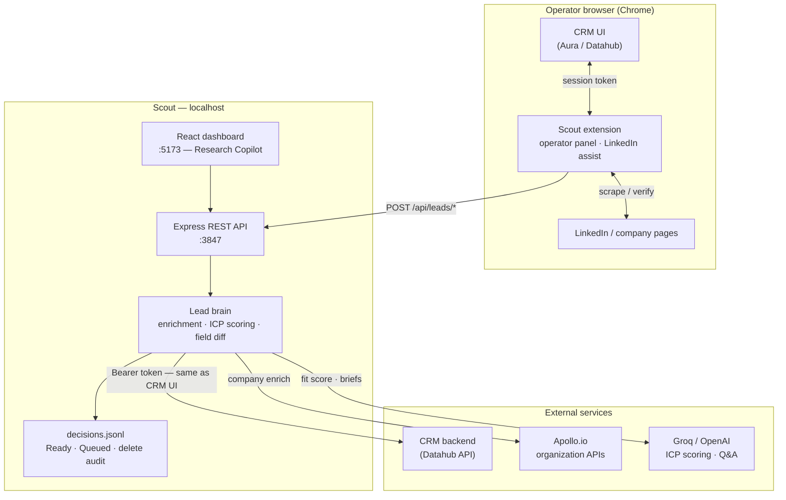
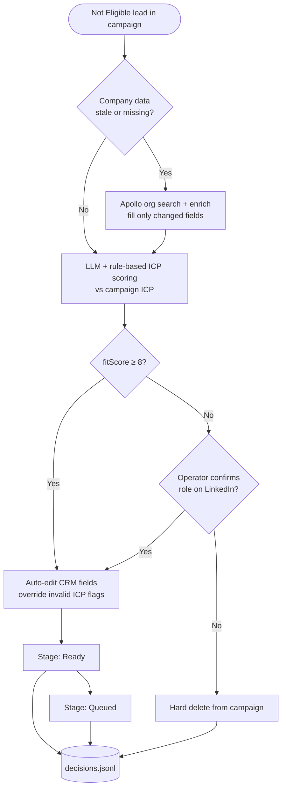
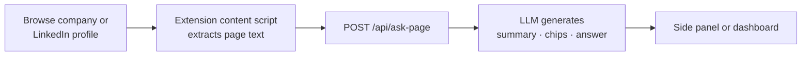
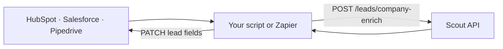

# Scout

**AI lead operator for CRM** — enrich, score, and move leads to Ready/Queued without changing your CRM codebase.

Scout sits beside the CRM as a Chrome extension + local API. It automates the operator loop: pull **Not Eligible** leads → enrich company data → score ICP fit → **Ready** or **delete**.

> **Demo:** Fully integrated with **Aura/Datahub** (extension + Run automation).  
> **Other CRMs:** [examples/CONNECT-YOUR-CRM.md](./examples/CONNECT-YOUR-CRM.md) · [HubSpot](./examples/hubspot/) · [standalone API](./examples/standalone/)

Extension version: **1.7.6**

---

## What Scout does (Lead Operator)

| Step | Behavior |
|------|----------|
| **Scope** | Processes **Not Eligible** leads in campaigns |
| **Company enrichment** | Apollo org APIs fill stale/missing company fields (90-day staleness check) |
| **ICP scoring** | LLM scores fit vs campaign ICP (threshold: `LEAD_FIT_READY_THRESHOLD`, default **8**) |
| **Auto-ready** | Score ≥ 8 → auto-edit fields → **Ready** → **Queued** |
| **Manual path** | Score < 8 → operator confirms on LinkedIn |
| **No match** | Permanently **deleted** from campaign |

The Scout panel sits **center-top** on Aura campaign pages and is **draggable** (position remembered).

### Decision audit log

Every **Ready**, **Queued**, **reject**, **skip**, and **delete** is appended to:

```
server/data/decisions.jsonl
```

Override path with `SCOUT_DECISION_LOG_PATH` in `server/.env`. One JSON object per line — `fitScore`, `threshold`, `reason`, `stageAfter`, etc. Use this to tune ICP threshold and measure precision/recall over time.

---

## Connect your CRM

| CRM | How |
|-----|-----|
| **Aura / Datahub** | Built-in — load extension, open campaign, Run automation ([Quick start](#quick-start)) |
| **HubSpot** | [examples/hubspot/](./examples/hubspot/) |
| **Salesforce, Pipedrive, others** | [examples/CONNECT-YOUR-CRM.md](./examples/CONNECT-YOUR-CRM.md) |
| **No CRM (API only)** | [examples/standalone/](./examples/standalone/) |

Apollo is an **optional enrichment source inside Scout** — not a replacement for your CRM workflow.

---

## Research Copilot (second mode)

Original Scout for investors/recruiters — still available:

1. Visit a company or LinkedIn page
2. Open Scout → scout the page
3. Ask questions in the side panel or dashboard ([dashboard](http://localhost:5173))

---

## Fit score threshold (`LEAD_FIT_READY_THRESHOLD`)

Default: **8 / 10**.

| | |
|--|--|
| **Meaning** | Minimum LLM/rule fit score for auto-Ready; below → manual verify or delete |
| **Why 8** | Intentionally high — Ready/Queued should mean strong ICP fit |
| **Tuning** | Set `LEAD_FIT_READY_THRESHOLD` in `server/.env` (e.g. `7` for looser campaigns) |
| **Eval** | Review `server/data/decisions.jsonl` — compare scores to operator outcomes |

---

## Auth & trust model

Scout does **not** implement its own login. It reuses the **CRM operator session**:

- Extension reads `auth_token` from CRM page storage and Datahub URL from the page / user profile.
- Requests to Scout include `{ crm: { authToken, datahubBaseUrl } }` (or `x-crm-token` / `x-datahub-url` headers).
- Scout forwards that Bearer token to Datahub — same trust boundary as the CRM UI.

**Limits (by design today):**

| Topic | Behavior |
|-------|----------|
| Token expiry | No Scout-side refresh. If CRM session expires, Run/Confirm fail until re-sign-in |
| Rate limiting | Scout API has per-service limits; LLM providers may 429 (fallback across providers) |
| Production hardening | Bind Scout to localhost, don't expose `:3847` publicly, keep tokens out of logs |

---

## Architecture

Scout runs **beside** your CRM — no fork, no CRM code changes. The extension reuses the operator’s CRM session; the local API orchestrates enrichment, scoring, and writes results back.

### System overview



### Lead operator flow

Each **Not Eligible** lead moves through enrichment → scoring → a logged decision:



### Research Copilot flow (second mode)



### Any CRM (API bridge)

For non-Aura CRMs, a script or integration layer calls Scout’s REST API and writes results back:



See [examples/CONNECT-YOUR-CRM.md](./examples/CONNECT-YOUR-CRM.md).

### Repository layout

```text
scout/
├── extension/     Chrome MV3 — CRM operator UI, dock panel, LinkedIn assist
├── server/        Node.js / TypeScript — API, lead brain, decision log, tests
├── dashboard/     React + Vite — knowledge base & Research Copilot Q&A
├── examples/      HubSpot script, standalone enrich CLI, CRM connect guide
└── scripts/       Utilities (icons, etc.)
```

---

## Quick start

### 1. Install

```bash
cd scout
npm install
```

### 2. Configure

```bash
cp server/.env.example server/.env
```

```env
PORT=3847
GROQ_API_KEY=gsk_...
# or OPENAI_API_KEY=sk_...

DATAHUB_BASE_URL=https://app.example.com/datahub

LEAD_FIT_READY_THRESHOLD=8
APOLLO_API_KEY=your_apollo_api_key_here   # optional enrichment

# Optional: override decision audit log path
# SCOUT_DECISION_LOG_PATH=./data/decisions.jsonl
```

### 3. Run server (+ optional dashboard)

```bash
npm run dev
```

- API: http://localhost:3847
- Dashboard: http://localhost:5173

### 4. Load the extension

1. Open `chrome://extensions`
2. Enable **Developer mode**
3. **Load unpacked** → select `extension/`
4. After code changes: **Reload** the extension, then refresh Aura

### 5. Operator flow

1. Sign in to **Aura**
2. Open a campaign: `/dashboard/campaigns/{id}`
3. Scout panel appears (center-top) — drag if needed
4. Click **Run automation**
5. Refresh the Aura leads table
6. Review decisions: `server/data/decisions.jsonl`

### 6. Run tests

```bash
npm test -w server
```

---

## API (lead brain)

Base: `http://localhost:3847/api`

| Method | Path | Description |
|--------|------|-------------|
| GET | `/leads/queue/:campaignId` | Not Eligible leads with LinkedIn URLs |
| GET | `/leads/resolve/:campaignId` | Match profile → campaign lead |
| GET | `/leads/icp/:campaignId` | Campaign ICP |
| POST | `/leads/process` | Score / apply |
| POST | `/leads/analyze` | Score only |
| POST | `/leads/apply` | Apply with operator verify |
| POST | `/leads/company-enrich` | Apollo company enrichment (CRM-agnostic) |
| POST | `/leads/delete` | Permanently remove leads from campaign |
| POST | `/leads/enrich-and-ready` | Waterfall enrich → Ready |

See [examples/CONNECT-YOUR-CRM.md](./examples/CONNECT-YOUR-CRM.md) for CRM-agnostic integration.

---

## Design choices

- **No Aura fork** — Scout calls the same Datahub APIs Aura uses.
- **Hard delete on fail** — failed verifies are removed from the campaign (logged).
- **Location override** — uses ICP `expected_values` / campaign geo when location blocks eligibility.
- **Decision log** — every Ready/delete outcome recorded for threshold tuning.

---

## Production readiness

| Feature | Details |
|---------|---------|
| **Caching** | In-memory TTL cache for Apollo (15 min default) |
| **Retry** | Exponential backoff + circuit breaker for external APIs |
| **Metrics** | `/metrics` — counters, gauges, histograms |
| **Logging** | Structured JSON logs + `decisions.jsonl` audit trail |
| **Health** | `/health`, `/ready` endpoints |

---

## License

MIT
